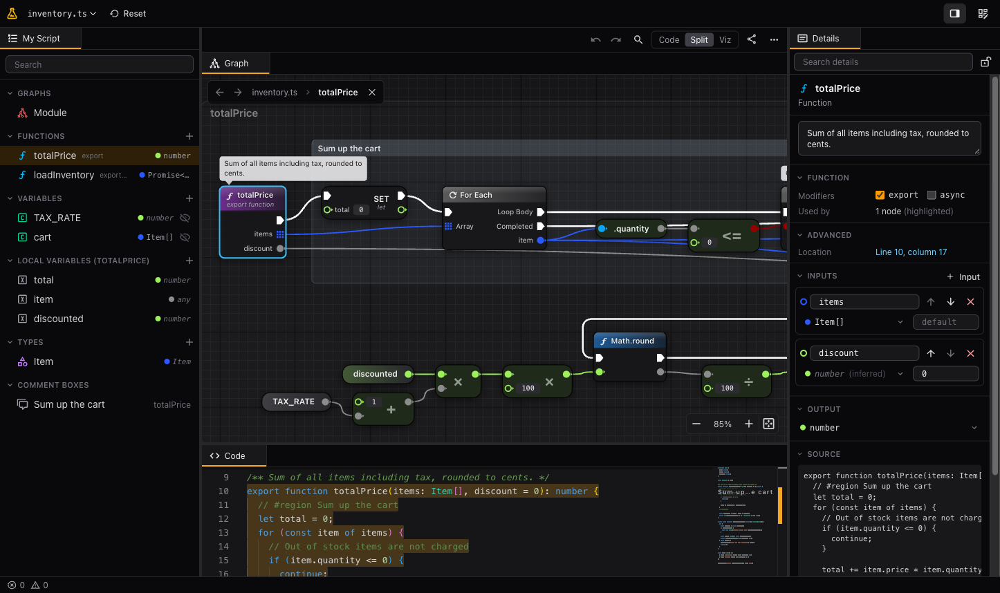

# vizscript

Visualize source code as Unreal-Engine-Blueprint-style node graphs.



Open a repository and pick a script. vizscript shows it as code, as a node graph, or both side by side, and keeps them in sync. The graph has two kinds of wires:

- **Exec wires** (white) show the order in which the code runs.
- **Data wires** (colored by type) connect values, such as variables, parameters and call results, to the inputs that use them.

Editing the graph edits the code: every change becomes a minimal text edit, so formatting and comments survive.

> Status: proof of concept. JavaScript/TypeScript, Python and GDScript (Godot 4) are supported. Committing changes back, more languages and more providers are planned (see [Roadmap](#roadmap)).

## Highlights

- **Blueprint concepts for any script.** Statements become nodes on the exec chain, expressions become pure nodes, and `if`, loops, `switch` and `try` become flow-control nodes. Every function gets its own graph.
- **Code and graph stay linked.** Hovering or selecting nodes highlights their code; moving the cursor in the editor highlights the matching node. Double-click a node to jump to its code.
- **Edit in either view.** Rewire pins, reorder statements, edit values inline, add nodes from a searchable action menu (drag a wire into empty space and start typing, with a **Context Sensitive** filter like Blueprint's), delete nodes or just their wires. Undo and redo cover both views.
- **Comments from the code.** A comment above a statement becomes a bubble over its node; a region (`// #region Title` in TypeScript, `#region` in GDScript, `# region` in Python) becomes a comment box around its nodes. Editing them in the graph rewrites the comment.
- **Problems like Compiler Results.** Nodes with an error or warning get a red **ERROR!** or yellow **WARNING!** banner, and a Problems panel lists them all (Shift + Ctrl/Cmd + M). TypeScript and JavaScript are type-checked; GDScript and Python report syntax errors.
- **Go to file and definition.** Ctrl/Cmd + click an import to open that file, or press `F12` on a node to jump to its definition, like in VS Code.
- **Shared layouts.** A file you open for the first time is laid out automatically. Once you rearrange it, the layout, including reroute points, is shared with everyone who opens the file on that branch.
- **A workbench like VS Code's.** Explorer, Code, Graph, Details and Problems views can be moved, split, resized and hidden; preset layouts are one click away. Light and dark mode follow your system or your choice.
- **Links keep the view.** The graph's position and zoom are part of the URL, so a shared link shows exactly what you saw.
- **Markdown preview** with GitHub-flavoured Markdown, highlighted code blocks and links that open repository files inside vizscript.

## Try it

Run everything in containers, then open http://localhost:8080:

```sh
APP_SECRET=$(openssl rand -base64 48) docker compose up --build
```

- The **playground** (`/playground`) works without signing in and comes with samples in every supported language.
- To browse your repositories, sign in with a GitHub [fine-grained token](https://github.com/settings/personal-access-tokens/new) that has read access to _Contents_ and _Metadata_.

To run it from source or to contribute, see [CONTRIBUTING.md](CONTRIBUTING.md).

## Working with the graph

| Action                       | Input                                                                                                |
| ---------------------------- | ---------------------------------------------------------------------------------------------------- |
| Pan                          | Right or middle drag, Space + drag, or two-finger scroll                                             |
| Zoom                         | Mouse wheel, Ctrl + scroll, or pinch                                                                 |
| Select / multi-select        | Click, Shift + click (add), Ctrl/Cmd + click (toggle), drag a marquee                                |
| Select a whole function      | Click its frame title                                                                                |
| Move                         | Drag a node; all selected nodes (and reroute points) move together                                   |
| Frame selection / everything | `F` / `Home`                                                                                         |
| Find nodes                   | Ctrl/Cmd + F, then Enter / Shift + Enter to step through the results                                 |
| Context menu                 | Right-click a node, pin, wire, reroute point, frame title or empty space                             |
| Jump to code                 | Double-click a node                                                                                  |
| Go to definition             | `F12` or right-click → Go to definition on a call or variable node                                   |
| Edit a value                 | Double-click an inline value on a pin, or use the details panel                                      |
| Rewire                       | Drag from a pin to another pin                                                                       |
| Reorder statements           | Drag an exec output onto another node's exec input                                                   |
| Add a node                   | Drag a wire out of any pin and release it on empty space (actions depend on the pin), or right-click |
| Add a reroute point          | Double-click a wire; Alt + click a reroute point removes it                                          |
| Disconnect                   | Alt + click a pin (the nodes stay, only the wire is removed)                                         |
| Problems panel               | Shift + Ctrl/Cmd + M, or the error / warning counter in the status bar                               |
| Delete                       | `Delete` / `Backspace`                                                                               |
| Undo / redo                  | Toolbar buttons, Ctrl/Cmd + Z, Ctrl/Cmd + Shift + Z                                                  |
| Comment a node               | Double-click its comment bubble, or right-click → Add comment                                        |
| Comment box around selection | `C`; double-click the box title to rename it, click it to select and move its nodes                  |

On phones the viewer is read-only: you can switch between code and graph, pan and pinch-zoom.

## Roadmap

- Commit graph edits back to the repository
- Sign-in through Keycloak with GitHub as identity provider
- GitLab and local folder providers
- More languages (C#, Rust, Go, C++, Ruby, …)
- Real type information for pins in all typed languages (e.g. through the TypeScript language service)
- Collapsing nodes to functions, comment boxes and reroute nodes
- Desktop app based on Tauri
- VS Code extension that shows the graph view inside VS Code

## Contributing

Contributions are welcome. [CONTRIBUTING.md](CONTRIBUTING.md) covers the setup, architecture, scripts and how to verify a change.

## License

[MIT](LICENSE)
